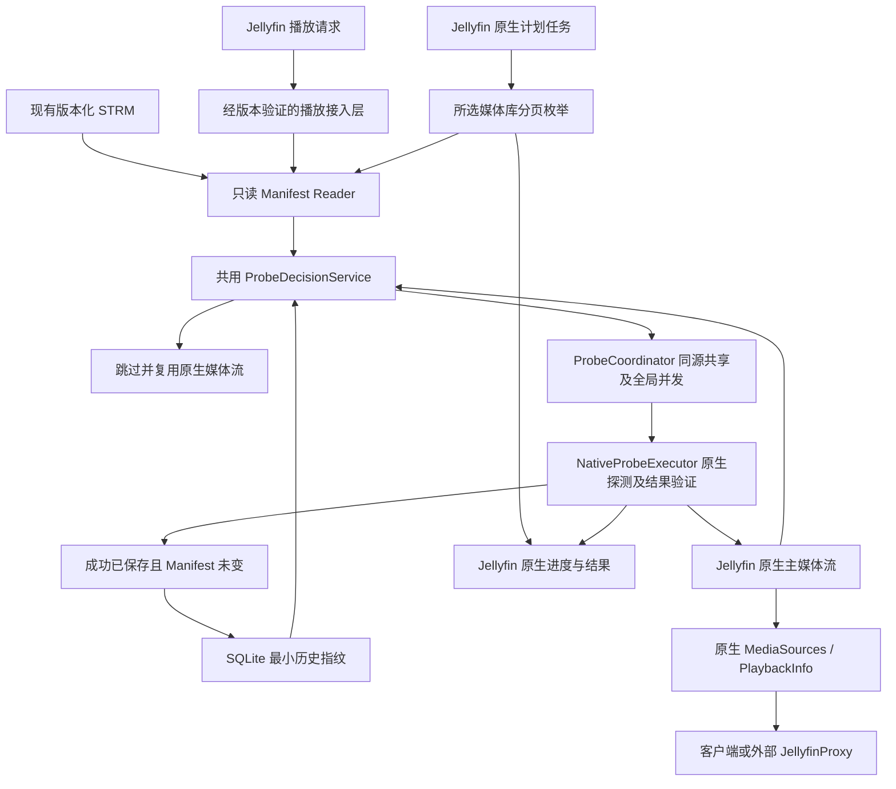

# 架构

## CURRENT

仓库有方案、规划文档、治理／历史初始化工具、CI 和隔离开发环境工具，没有 C# 产品项目、插件运行时服务、SQLite schema、配置页或插件包。V4.2 取代 V3.0 作为当前开发基准，旧原文与合同留在 Git 历史。

Slice 1 保留原始 Base 并修订核心验证合同。环境工具固定 SDK `10.0.401`，安装仍受沙箱限制；服务器镜像 digest／产品依赖未固定，隔离服务未运行，见 [环境交接](development-environment.md)。原生接入、成功信号和最新地址持久化没有实机证据。方案中的接口与 SQL 是目标设计，不能写成已经实现。

## TARGET



生成器／OpenList／代理均为外部系统。插件不调用 OpenList API，不写 STRM；调度、运行与停止由 Jellyfin 管理。

## 精简模块与责任

| 模块 | 边界 |
|---|---|
| Plugin／PluginConfiguration／ServiceRegistrator | 生命周期、有效配置、版本适配注册；不自建调度器 |
| 播放接入层（候选 IMediaSourceManager 包装） | 受支持 STRM 进入共同检查链，其余完整委托；保留 allowMediaProbe 权限 |
| StrmManifestReader | 有界本地只读与纯解析；字段验证无网络、数据库或刷新副作用 |
| ProbeDecisionService | 纯决策：RequireProbe／SkipProbe／Fallback；没有 UpdatePathOnly |
| ProbeCoordinator | 以 item_id＋source_key 共享内存进行中工作；全局许可默认 2、配置 1～8，播放／批量共用 |
| NativeProbeExecutor | 版本相关原生探测、关联本次结果、媒体流／地址持久化验证；评估 FullRefresh 附带开销 |
| StrmProbeScheduledTask | 候选 IScheduledTask／IConfigurableScheduledTask，分页所选库、有界消费、取消、原生进度及统计 |
| StrmFingerprintRepository | SQLite 最小历史指纹、条件提交与异常保护；不保存媒体信息或持久化探测状态 |

结果验证是 Executor 的必需责任，不因移除独立 Validator／Synchronizer 类而消失。首次验证后才决定具体代码组织，不预建空类。

建议目录均为 TARGET：

```text
src/Jellyfin.Plugin.StrmProbeOptimizer/
  Plugin.cs, PluginConfiguration.cs, ServiceRegistrator.cs
  Interceptors/                 # 若包装方案验证成立
  Services/                     # Reader、Decision、Coordinator、NativeExecutor
  Tasks/                        # StrmProbeScheduledTask
  Persistence/                  # StrmFingerprintRepository
  Configuration/                # 配置页，无独立任务管理 UI
tests/Jellyfin.Plugin.StrmProbeOptimizer.Tests/
tests/Jellyfin.Plugin.StrmProbeOptimizer.IntegrationTests/
```

## 指纹与提交

V4.2 最小表目标：

```sql
CREATE TABLE strm_fingerprint (
    item_id TEXT NOT NULL,
    source_key TEXT NOT NULL,
    url_hash TEXT NOT NULL,
    sha1 TEXT,
    file_size INTEGER,
    PRIMARY KEY (item_id, source_key)
);
```

没有 state、pending、probe_failed 或媒体流字段。url_hash 表示完整有效播放 URL 的身份，不等于媒体内容 SHA-1；不去掉签名参数以掩盖地址变化。SHA-1／Size 合法性、source_key 身份、指纹算法与事务细节在 Slice 2 固定。

| 检查结果 | 历史指纹操作 |
|---|---|
| 无指纹且已有必要主流 | 默认信任并初建指纹；确认当前原生地址可用，不称为本次探测成功 |
| 无主流／判断变化，但当前播放不允许探测 | 不执行、不提交变化；下一次重新比较 |
| 未变化／仅 mtime 变化／字段暂缺且不构成变化 | 复用；不拿不完整观测覆盖既有有效指纹 |
| 实际成功、有本次新结果、原生已保存、主流有效且前后 Manifest 一致 | 条件提交对应新指纹；缺少新 SHA-1 时不携带另一版本的旧 SHA-1 |
| 失败、取消、无法确认成功、文件解析错误或探测期间变化 | 保留旧指纹（若无则仍无）；原因只在运行结果／脱敏日志，不另存失败状态 |

执行前后读取 Manifest，关联媒体源身份与基线快照，提交时防止并发过期工作覆盖新基线。指纹写入失败不能返回“已提交成功”。重启后旧指纹与当前文件重新比较，即可恢复未完成检查需求。

首次信任是指纹提交例外，不能用缺少状态字段来宣称历史记录都已实测。若原生地址与当前文件不同，须通过原生处理得到正确地址，不能首次信任后继续返回已知旧 URL。

## 并发、取消与批量内存

先以媒体源身份汇合工作，再由唯一执行者占用全局许可；同源等待者不重复排队占许可。不同媒体源独立但共用总上限。排队后与结束后重新检查版本；信号量在所有结束路径释放。

调用者取消只结束自身等待。批量停止分页和排队，撤销自身等待；若仍有播放等待者，共享执行继续。没有任何等待者的工作是否取消及提交边界须在协调 Task 实测，不用首个请求的 cancellationToken 控制所有请求。

库查询使用稳定分页顺序、去重和有界生产／消费，不一次保存全库列表或为十万项创建十万个 Task。扫描并发增删项目时不误报完整静态快照；重读 STRM、防止旧版本提交。插件并发上限只覆盖主动发起的探测，外部原生刷新保持独立。

## 接入门槛与故障

Slice 1 先验证核心 DI、真正探测结果信号及原生地址持久化；失败时给出调整／阻塞结论，不绕过门槛铺开产品。任务接口源码定位不等于已加载或定时执行通过；实际注册、默认无触发时间、停止／进度在 Slice 3 验证。首版不接 ILibraryPostScanTask。

原生刷新成功返回、ItemUpdateType、旧主流和媒体更新事件均不足以确认本次成功。URL 改变必须实际原生探测，并使用已保存的新地址，不另加路径单独更新服务。

SQLite 运行时异常停止优化并尽可能原生委托，批量报告不可用而不转为全库强制刷新；核心注册失败明确报告，不承诺启动时总能自动回退。所有失败回退保留原调用探测权限。
