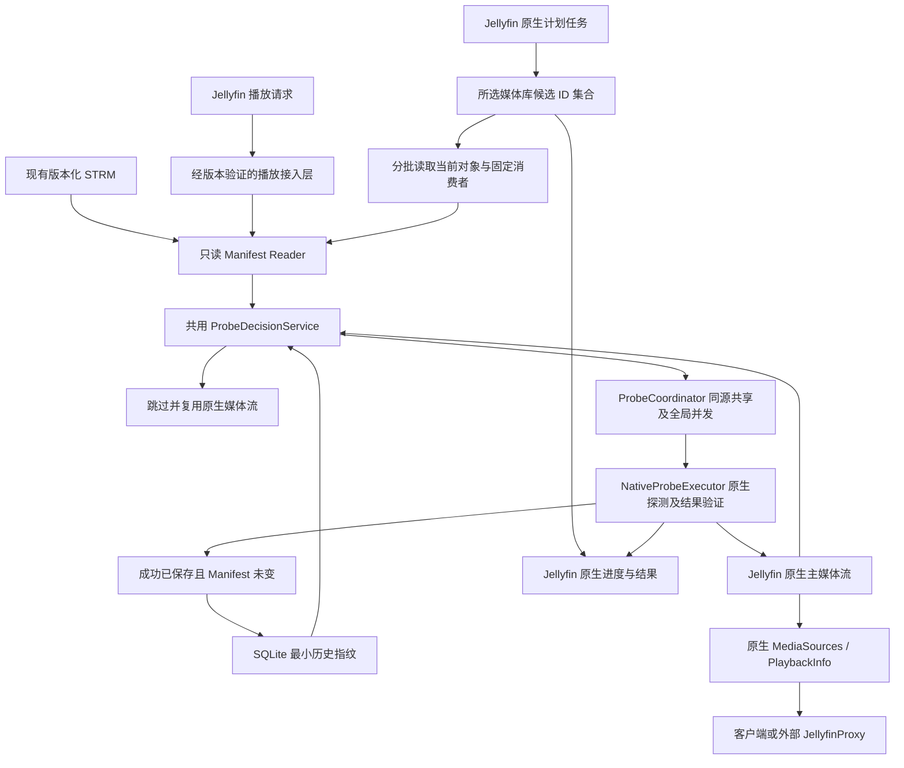

# 架构

## CURRENT

V4.3 是当前开发基准，仅修订批量扫描方式；V4.2／V3.0 原文与历史合同留在 Git。Slice 1 原型已经 A 最终审查 PASS / CLOSED；[关闭证据](progress.md#slice-1-closed) 保留原始边界。固定 Jellyfin `12.2.0`／源码 `ca0f16eb7c195f720a1493ed469a27c4657db0c6`、Controller／Model `12.2.0`、`net10.0`／SDK `10.0.401`；单版本事实不构成跨版本兼容承诺。

Slice 2 已由 A 审查完整 Base..Implementation Head 并裁定 PASS / CLOSED；接受实现 `59fd3f7e4b6623449a691574fb69b817db72c2ae`，Slice Base 固定为 `924816a84c74f5d79c107478f2d40e621cb8be8d`。Task 2.1／2.2 均 B PASS，单独 Slice Final 经 A 核验输入和原始产物后接受；当前 Slice 3 任务状态另见 [TASK.md](../TASK.md)。完整合同、Closure Packet 和 [A Final Review](progress.md#slice-2-closed) 保留必要结果及证据边界。

- 只读版本 1 解析及完整决策矩阵、原生所属项目／MediaSourceInfo.Id 的稳定多版本身份、五字段 SQLite 和 expectedPrevious 原子条件提交已接受。失败、原生自身取消异常、文件变化及过期结果保护可信基线；SQLite 异常停止优化，保留原权限与旧库，修复后重启重新检查。
- 共用 `CheckSourceAsync` 使用已有原生探测／事务保存关联；每个取得许可的 owner 先读本调用者当前源，再核对 Manifest／指纹／启停后行动，立即获许可也重判。首次信任核对当前 Manifest 与原生地址，不称为本次探测成功。
- `ProbeCoordinator` 用同一短时锁协调同键查询、准备登记、实际开始转换和结束移除。准备工作只供其他请求等待后重查；匹配 `IMediaEncoder.GetMediaInfo` 调用处才登记 running。同源共享探测，调用者仍按各自 user／选源／路径替换获取响应。完成项不作为运行中缓存；`Complete`／`Fail`／`Abandon` 幂等结算。等待者全部退出不取消已开始工作，成功时仍按全部条件提交。
- 全局池惰性创建并消费启动时捕获的并发值，默认 2、合法 1～8；保存并发只在下次启动生效。Enabled／PlaybackAutoCheck／DetailedLog 保存成功后下一请求生效；关闭播放检查仅影响播放入口。配置先完整写入临时文件再原子替换，失败保留旧有效文件与内存，必要错误诊断脱敏。
- B 独立聚焦 81/81、六项边界控制、默认实机及未安装插件／PlaybackAutoCheck 下一请求补充对照通过。实机核对同源一次开始／提交、默认 2／重启前保存 1 仍为 2／重启后为 1、池饱和时独立 FullRefresh、多版本及 SQLite／原生地址主流重启恢复。证据索引 `.git/validation-evidence/59fd3f7e4b6623449a691574fb69b817db72c2ae/b-rereview-20261014-08/INDEX.md`，完整 Task 2.2 计划／报告／B PASS 在 `76cd9e997548c4ffef04a8dd8f9b0d4ef4376347:TASK.md`；Task 2.1 在 `13cb8bdac319fcf0b3e7500661bae1c7455077b0:TASK.md`。历史失败保留在 Git 和原始证据，不堆叠在 CURRENT。

单独 Slice Final 112 项 C#、30 项 Python 及全部构建／质量／默认隔离实机／补充对照通过；A 核验 40 个可执行输入、27 个产物和八个规范章节，另独立重跑 C# 112/112。真实 Final 明确复用，未声称 A 再次实机运行。本机索引位于 `.git/validation-evidence/59fd3f7e4b6623449a691574fb69b817db72c2ae/` 下的 `slice-final-20261014-09/INDEX.md` 与 `a-final-review-20261014/INDEX.md`，完整结果见 [Closure Packet](progress.md#slice-2-closed)。

控制验证使用假原生／保存代理和临时 STRM；真实 Jellyfin 内部数据库保存故障注入、音频-only 实机、完整镜像构建溯源及通用 FullRefresh 性能证明仍未运行。固定组合事实不构成跨版本承诺。HTML 完整配置页、原生批量、外部代理和发布尚未交付；目标边界不变。

### Slice 1 关闭时的 Task 1.1 原型边界

- `ServiceRegistrator` 在 Jellyfin 核心服务注册后包装唯一的 `IMediaSourceManager`、`IMediaEncoder`、`IMediaStreamRepository` 与 `IItemPersistenceService` 实例；未匹配方法委托给对应原生实现。单元测试核对核心注册和生命周期，隔离实例验证实际插件启动、禁用、恢复与加载。
- `StrmManifestReader` 有界只读解析版本化 STRM；`ProbeDecisionService` 实现该原型所需的 URL／SHA-1／Size 决策。`StrmPlaybackOptimizer` 只接管允许探测的受支持 `.strm`；其他请求保留 Jellyfin 原始权限并委托原生路径。
- `ProbeExecutionContext` 记录本次请求 URL 的编码器主流身份；保存代理只在原生 `SaveMediaStreams`／`SaveItems` 成功返回后记录对应主流和地址。接入层再核对 Jellyfin 返回源、已保存主流、最新地址及未变化的 STRM，满足条件后才提交进程内指纹。单元测试覆盖旧流仍在和原生保存抛错；隔离实例观察到真实成功保存与返回流相符。隔离实例没有对 Jellyfin 内部数据库注入保存故障，B 已核对固定源码事务边界、独立保存失败 harness 与实际成功保存／重启证据；该结果不宣称实机数据库故障注入。
- Slice 1 关闭时的原型使用进程内条件提交；重启后需要首次信任接管。Slice 2 已接受的实现新增 SQLite 持久化、真实源身份和运行中协调。该 Slice 1 关闭原型未实现同源并发协调、批量任务、完整配置 UI、全产品矩阵或跨 Jellyfin 版本承诺。
- 隔离实测覆盖普通文件、旧 STRM、Live TV、禁用插件、false 权限的实际流请求、手动 FullRefresh 和探测期间 STRM 变化。固定版本的 PlaybackInfo 固定传 `allowMediaProbe=true`；可取消的媒体流入口传 `false`，故 false 实测通过真实流 API，不能宣称为 PlaybackInfo 的 false 参数测试。提交后地址变化连续三次观察到匹配探测、`GetMediaInfo` 调用和本地媒体 GET；手动 FullRefresh 更新条目 ETag，但未运行这些探测，后续地址变化仍触发探测。精确证据和性能限制见 [兼容性记录](compatibility.md)。

### 播放与任务执行上下文

播放接入保留原调用的 token 与探测权限。获取 PlaybackInfo 并不保证实际探测；插件未变化复用分支会使用原生不探测取源。当前 PlaybackInfo 传 `CancellationToken.None`，客户端退出及停止播放不连接到本次探测取消；不新增 `RequestAborted` 关联或 PlaybackStopped 事件取消器。客户端退出后，执行仍成功且结果已保存、Manifest 一致时，可继续按条件提交。

批量尚未实现；原生计划任务的停止 token 在目标设计中仅用于候选获取边界、后续批次和未实际开始的工作，不传给已开始探测，也不否决其满足全部成功条件后的提交。已开始工作正常收尾，即使没有其他等待者。用户停止／共享规则已由 A 作为 [Slice 2 Material Contract Change 记录](progress.md#slice-2-closed) 同步；Slice 2 取消人为可取消执行实机门槛，原生取消异常仍保留基线并传播，Slice 3 验证实际批量停止与收尾。固定版本入口见 [兼容性](compatibility.md#播放与批量取消语义)。

## TARGET

[Slice 3 合同](../SLICE.md) 已激活，Base 为 Slice 2 关闭提交 `6da90ab6bd8995d8204ae0b7faf786c823699fe6`，本轮按用户授权实质修订为候选 ID 集合＋分批对象读取，Task 3.1 合法性与状态见 [TASK.md](../TASK.md)。当前代码仍未提供批量任务／范围配置／HTML 页；以下批量设计不是已实现事实。新增入口必须区分批量准入停止与已开始探测收尾，并在批量不可用时停止枚举，不能直接复用现有允许原生委托的播放回退。范围按每次运行固定，候选 ID 集合允许 O(N) 内存，完整媒体对象／活动工作按批次有界；进度、按源统计及配置生效约定见合同；真实任务／定时／停止／页面交互仍 NOT RUN。



生成器／OpenList／代理均为外部系统。插件不调用 OpenList API，不写 STRM；调度、运行与停止由 Jellyfin 管理。

## 精简模块与责任

| 模块 | 边界 |
|---|---|
| Plugin／PluginConfiguration／ServiceRegistrator | 生命周期、有效配置、版本适配注册；不自建调度器 |
| 播放接入层（候选 IMediaSourceManager 包装） | 受支持 STRM 进入共同检查链，其余完整委托；保留 allowMediaProbe 权限 |
| StrmManifestReader | 有界本地只读与纯解析；字段验证无网络、数据库或刷新副作用 |
| ProbeDecisionService | 纯决策：RequireProbe／SkipProbe／Fallback；没有 UpdatePathOnly |
| ProbeCoordinator | 以 item_id＋source_key 只共享实际已开始的运行中探测；排队不作为共享执行，已开始工作独立收尾；全局许可默认 2、配置 1～8，播放／批量共用 |
| NativeProbeExecutor | 版本相关原生探测、关联本次结果、媒体流／地址持久化验证；评估 FullRefresh 附带开销 |
| StrmProbeScheduledTask | 候选 IScheduledTask／IConfigurableScheduledTask，所选库候选 ID 集合、分批对象／固定消费者、停止收尾、原生进度及统计 |
| StrmFingerprintRepository | SQLite 最小历史指纹、条件提交与异常保护；不保存媒体信息或持久化探测状态 |

结果验证是 Executor 的必需责任，不因移除独立 Validator／Synchronizer 类而消失。首次验证后才决定具体代码组织，不预建空类。

建议目录均为 TARGET：

```text
src/Jellyfin.Plugin.StrmProbeOptimizer/
  Plugin.cs, PluginConfiguration.cs, ServiceRegistrator.cs
  Interceptors/                 # 若包装方案验证成立
  Services/                     # Reader、Decision、Coordinator、NativeExecutor
  Tasks/                        # StrmProbeScheduledTask
  Persistence/                  # StrmFingerprintRepository
  Configuration/                # 配置页，无独立任务管理 UI
tests/Jellyfin.Plugin.StrmProbeOptimizer.Tests/
tests/Jellyfin.Plugin.StrmProbeOptimizer.IntegrationTests/
```

## 指纹与提交

V4.2 最小表目标：

```sql
CREATE TABLE strm_fingerprint (
    item_id TEXT NOT NULL,
    source_key TEXT NOT NULL,
    url_hash TEXT NOT NULL,
    sha1 TEXT,
    file_size INTEGER,
    PRIMARY KEY (item_id, source_key)
);
```

没有 state、pending、probe_failed 或媒体流字段。url_hash 表示完整有效播放 URL 的身份，不等于媒体内容 SHA-1；不去掉签名参数以掩盖地址变化。SHA-1／Size 合法性、source_key 身份、指纹算法与事务细节在 Slice 2 固定。

| 检查结果 | 历史指纹操作 |
|---|---|
| 无指纹且已有必要主流 | 默认信任并初建指纹；确认当前原生地址可用，不称为本次探测成功 |
| 无主流／判断变化，但当前播放不允许探测 | 不执行、不提交变化；下一次重新比较 |
| 未变化／仅 mtime 变化／字段暂缺且不构成变化 | 复用；不拿不完整观测覆盖既有有效指纹 |
| 实际成功、有本次新结果、原生已保存、主流有效且前后 Manifest 一致 | 条件提交对应新指纹；缺少新 SHA-1 时不携带另一版本的旧 SHA-1 |
| 失败、原生执行自身取消异常、无法确认成功、文件解析错误或探测期间变化 | 保留旧指纹（若无则仍无）；批量停止不属于该执行取消，已开始探测仍可按全部成功条件提交；不另存失败状态 |

执行前后读取 Manifest，关联媒体源身份与基线快照，提交时防止并发过期工作覆盖新基线。指纹写入失败不能返回“已提交成功”。重启后旧指纹与当前文件重新比较，即可恢复未完成检查需求。

首次信任是指纹提交例外，不能用缺少状态字段来宣称历史记录都已实测。若原生地址与当前文件不同，须通过原生处理得到正确地址，不能首次信任后继续返回已知旧 URL。

## 并发、取消与批量内存

运行中共享登记只包含实际已进入原生探测调用且尚未结束的工作，开始信号须经接入层核验；仅创建 Task、排队、等待或取得许可都不算。未开始请求各自排队，保留调用者权限／生命周期；不把同键排队任务合并为共享执行。获得执行机会后重读 Manifest 和指纹，若同源已经实际开始才加入，否则按最新决策开始或复用已保存结果。协调开始竞态，避免同源重复实际执行；加入已开始探测不额外占全局许可。不同源独立，共用总上限；执行结束后释放许可／登记，等待者重查版本，不把完成任务缓存成运行中共享。

批量任务的停止在 Slice 3 处理：停止后续候选获取／批次读取，撤销本任务未实际开始的请求；不能取消其他调用者的排队请求。先确认停止的工作不再开始，已实际开始的工作继续完成，任务进入停止收尾并等待其结果结算。停止 token 不传播给已开始探测；原生保存／验证／指纹条件提交继续执行，不用批量停止 token 在成功返回后阻止有效提交。

等待者退出或数量为零均不取消已开始探测，不需要按等待者计数取消执行的机制，也不新增独立执行取消源。原生探测自身失败／取消异常仍保留旧基线并传播；成功必须满足本次真实探测、保存、主流和稳定 Manifest 条件。当前公共 PlaybackInfo 沿用 None token，不新增客户端断开／停止播放到探测取消的关联。

核心并发配置默认 2、可保存 1～8，下一次 Jellyfin 启动生效；保存说明须明确，不要求 Slice 2 热调整已有许可池。核心配置通过 Jellyfin 已有保存通道提供，完整配置页仍在 Slice 3。

批量使用目标版本原生 `ILibraryManager.GetItemIds`，按所选库关系和同一过滤取得物理媒体项 ID；包含 alternate versions，关闭展示聚合。允许一次取得全部候选身份，去重后以确定顺序固定本轮 ID 序列，不依赖名称／原生 offset 排序。按固定批次使用 `GetItemList(ItemIds=批次ID)` 读取当前对象，并通过原生库关系重核范围；消失／移出者安全结算，新增留下一轮。固定消费者处理当前批次，整批结算后才读取下一批，不要求独立生产者／等待队列，也不为每个 ID 创建 Task。

ID 获取完成前不开始对象处理；任一所选库获取失败时报告不可用，不按部分候选继续。原生同步 ID／对象查询无 token 时只在调用前后检查停止／禁用，调用中停止等返回，返回后不准入；不使用脱离任务的后台获取伪装取消。旧轮执行保持未结束，待本轮已开始／已加入探测完成保存、指纹提交、统计与资源结算后抛停止异常；原生 Cancelling 结束后才允许下一轮批量实际运行。

全部候选 ID、合并去重／排序副本及原生查询临时分配可能随 N 增长，独立观测获取耗时、数量、内存及停止延迟；只对当前批次完整媒体对象和固定消费者宣称上限。候选身份不是事务快照，不能替代当前 Manifest／指纹／主流与条件提交校验。候选获取阶段进度 0%，之后以去重 ID 数为分母、按候选结算推进；所有受支持源统计另按项目＋源去重，首次信任不算探测成功。修复或停止后重跑重新获取 ID，不保存分页位置／失败队列。插件并发上限仍只覆盖主动探测，外部原生刷新独立。

## 接入门槛与故障

Slice 1 先验证核心 DI、真正探测结果信号及原生地址持久化；失败时给出调整／阻塞结论，不绕过门槛铺开产品。任务接口源码定位不等于已加载或定时执行通过；实际注册、默认无触发时间、停止／进度在 Slice 3 验证。首版不接 ILibraryPostScanTask。

原生刷新成功返回、ItemUpdateType、旧主流和媒体更新事件均不足以确认本次成功。URL 改变必须实际原生探测，并使用已保存的新地址，不另加路径单独更新服务。

SQLite 运行时异常停止优化并尽可能原生委托，批量报告不可用而不转为全库强制刷新；核心注册失败明确报告，不承诺启动时总能自动回退。所有失败回退保留原调用探测权限。
