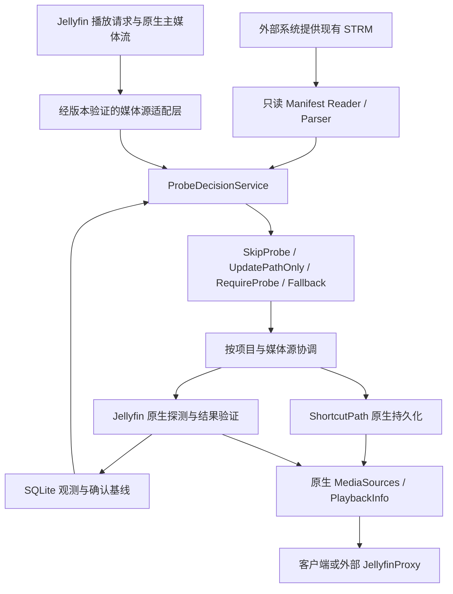

# 架构

## CURRENT

当前只有原始方案、范围与开发合同、治理／初始化脚本及 CI 文件。没有 C# 项目、运行时服务、SQLite schema、配置页或插件包。

Git 基线与 Slice 1 合同已本地提交；尚无产品实现。目标 Jellyfin、.NET SDK 和包依赖尚未选定，不能从源码标签存在推导二进制兼容。三个核心接入问题尚无实机证据。

## TARGET



外部生成系统不属于仓库实现。插件到 OpenList 元数据 API 没有调用链。

## 模块

| 模块 | 输入／输出与边界 |
|---|---|
| Plugin／Configuration／ServiceRegistrator | 插件生命周期与配置；只在已验证版本注册适配 |
| OptimizedMediaSourceManager | 限定受支持 STRM，其余接口完整委托，保持原始 allowMediaProbe 权限 |
| StrmManifestReader | 有界只读本地 STRM；不写文件、不请求远程 |
| StrmManifestParser | 纯解析，URL／内容 SHA-1／可空字节 Size／协议版本 |
| ProbeDecisionService | 纯决策，使用有身份关联的历史基线；首次接管单独处理 |
| ProbeCoordinator | 项目与媒体源级进行中任务，版本重检查和取消语义 |
| ProbeExecutor | Jellyfin 版本适配的原生探测入口，评估 FullRefresh 附带提供器开销 |
| ProbeResultValidator | 将本次执行证据、新流持久化、必要主流和 Manifest 一致性关联起来 |
| ShortcutPathSynchronizer | 原生保存最新 URL 并重新取得 MediaSources，不清除原流 |
| SqliteProbeStateRepository | 最小观测、基线与状态；不保存完整 URL、PlaybackInfo 或媒体流 |

建议实施目录：

```text
src/Jellyfin.Plugin.StrmProbeOptimizer/
  Plugin.cs, PluginConfiguration.cs, ServiceRegistrator.cs
  Interceptors/
  Services/
  Models/
  Persistence/
  Configuration/
tests/Jellyfin.Plugin.StrmProbeOptimizer.Tests/
tests/Jellyfin.Plugin.StrmProbeOptimizer.IntegrationTests/
```

以上路径是 TARGET；Task 1.1 核实版本后创建真实项目。当前不生成空类伪装成可构建插件。

## 状态与确认边界

逻辑状态：`Assumed`、`Verified`、`PendingProbe`、`ProbeFailed`。观测记录与确认基线分离，具体 SQLite schema、迁移和事务由 Slice 2 确定。

| 事件 | 状态动作 |
|---|---|
| 首次接管且已有必要主流 | 建立 Assumed，不宣称实测 |
| 首次缺主流或判断版本变化 | 保留／建立 PendingProbe |
| allowMediaProbe=false | 保留 PendingProbe；不执行探测 |
| 探测实际成功、新流已保存且 Manifest 未变 | 提交关联版本的 Verified |
| 探测失败或取消 | 保留确认基线，待测版本不提交；失败状态记录原因 |
| 探测期间 Manifest 改变 | 旧结果不能确认当前版本；保留最新待验证需求 |
| 内容相同而 URL 改变，路径保存成功 | 接受新 URL 指纹，复用同一内容的流；Assumed 不自动升级 Verified |

历史 SHA-1 暂时缺失时保留对应版本的信息，但不能把这个哈希带到另一内容基线。仅 `RefreshMetadata` 返回成功、`ItemUpdateType` 或数据库中仍有旧流，都不足以提交新版本。

URL 指纹只表示有效播放 URL 身份，必须涵盖影响地址的部分；不能把签名查询参数随意去掉以制造“未变化”。内容 SHA-1 表示媒体身份，两者不能混用。指纹算法、URL 比较和多版本键在实施合同内明确。

## 接入与故障

包装 `IMediaSourceManager` 是候选方案，必须验证注册顺序、原生实例唯一性、循环依赖、释放所有权、全部接口委托、普通播放与直播。若核心包装不稳定，Slice 1 给出证据和调整建议，不能先绕过此门槛继续 Slice 2。

要求探测的请求必须能够实际触发原生探测；不能只把 `allowMediaProbe` 设为 true 并假设结果。所有回退仍保留原始调用的探测权限。

SQLite 运行时异常尽可能委托原生处理，不覆盖可信状态。核心服务注册失败属于启动接入问题，不能用运行时 try/catch 承诺“肯定能回退”。路径同步失败不能返回旧地址并宣称已经更新。
