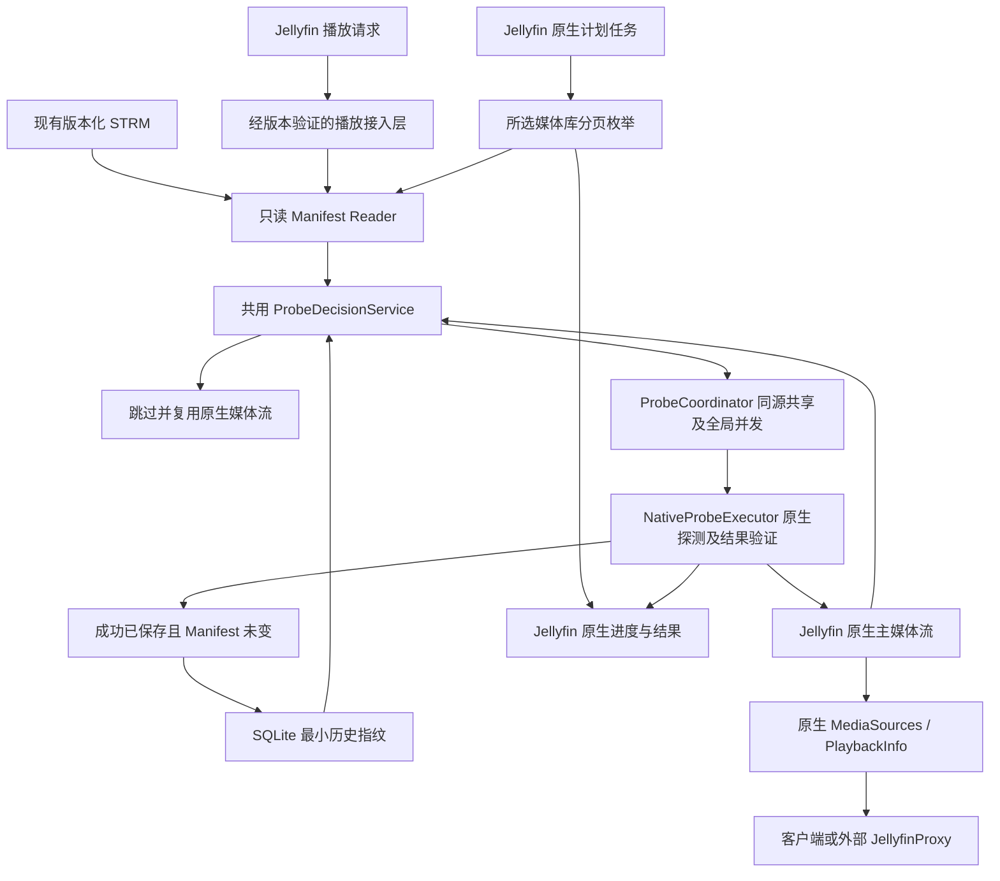

# 架构

## CURRENT

V4.2 是当前开发基准，V3.0 原文与合同留在 Git 历史。Slice 1 原型已经 A 最终审查 PASS / CLOSED；[关闭证据](progress.md#slice-1-closed) 保留原始边界。固定 Jellyfin `12.2.0`／源码 `ca0f16eb7c195f720a1493ed469a27c4657db0c6`、Controller／Model `12.2.0`、`net10.0`／SDK `10.0.401`；单版本事实不构成跨版本兼容承诺。

Slice 2 为 ACTIVE，Base 固定为 `924816a84c74f5d79c107478f2d40e621cb8be8d`，Implementation Head 为 `198f4ff2accd5bc9fcd87518a9684b9d068de103`。Task 2.1 已经 B 独立复审 PASS：完成只读解析／完整逻辑矩阵、实际项目／媒体源映射、SQLite 最小指纹、共用源检查／可靠提交及失败重启恢复。

Task 2.2 候选 `d651950950d6d3ad2be4322ddf8f0afb658c7755` 经 B 独立审查为 **FIX REQUIRED**。指定聚焦 C# 60/60 通过，但边界／配置控制对照复现：原生匹配探测尚未开始就登记共享；排队取得许可后仍用旧 Manifest／基线且不重读启停；配置中途写入失败破坏旧文件；非法配置诊断输出私有路径。还缺原计划的边界上限、零等待者、不同调用者及配置／外部刷新对照证据。修正在同一 Task 内进行，完整结果见 [B Review Result](../TASK.md#b-review-result)；SLICE 合同与已接受 Implementation Head 保持不变。完整配置页、原生批量与发布仍延期。

已接受的 Task 2.1 按原生所属项目及 `MediaSourceInfo.Id` 关联各版本 STRM 和五字段 SQLite 主键；事务核对 expectedPrevious，过期执行／插入竞争不覆盖已接受基线。保存代理关联本次结果及原生事务成功；首次信任、复用、探测成功与未完成分别记录。SQLite 读／写故障停止优化并尽可能原生委托，损坏／未知 schema 不自动删库重建；修复后重启再次检查。隔离实机验证成功及失败变化跨重启、多版本选源、同内容换 URL、同 URL 内容／Size 变化、mtime／重放和不可写恢复。SQLite 托管与原生运行依赖已部署加载。

Task 2.1 分层输入／原始日志、独立保存失败对照与实机证据见 [当前指针](progress.md) 及本机 `.git/validation-evidence/198f4ff2accd5bc9fcd87518a9684b9d068de103/b-rereview-20261014-03/INDEX.md`。B 独立控制验证使用真实 SQLite，但未对 Jellyfin 内部数据库注入保存故障；音频必要主流有原生适配控制证据，音频-only STRM 实机仍未验证。完整 Slice Final、批量、代理联调及发布 NOT RUN。

### Task 2.2 候选（FIX REQUIRED，未接受）

- 候选新增进程内 ProbeCoordinator、共享等待后按本调用者重读源、启动并发值的惰性许可池和四项核心配置；默认／部分保存／重启及代表性实机有 Developer 原始成功记录。
- 当前 TryMarkStarted 位于原生 GetPlaybackMediaSources 之前，MarkCall 未接协调开始通知；该登记表示刷新准备，不能称为匹配探测已实际开始。等待许可返回 owner 后也没有版本／基线／启停准入重查。
- 配置更新先保存再发布仅保护失败时的内存；原生 XML 写入会截断原文件，中途失败保护尚未满足。非法配置日志包含 ConfigurationFilePath，必须脱敏。
- Developer 索引 `.git/validation-evidence/d651950950d6d3ad2be4322ddf8f0afb658c7755/developer-t4-20261014-0203/INDEX.md` 保留原始 91/91、30/30 和默认实机成功；B 索引 `.git/validation-evidence/d651950950d6d3ad2be4322ddf8f0afb658c7755/b-review-20261014-04/INDEX.md` 记录独立聚焦 60/60 与 7 个控制失败观测。B 默认实机及 Slice Final 本轮 NOT RUN，先修正明确阻塞，再为新候选执行完整 T4。

### Slice 1 关闭时的 Task 1.1 原型边界

- `ServiceRegistrator` 在 Jellyfin 核心服务注册后包装唯一的 `IMediaSourceManager`、`IMediaEncoder`、`IMediaStreamRepository` 与 `IItemPersistenceService` 实例；未匹配方法委托给对应原生实现。单元测试核对核心注册和生命周期，隔离实例验证实际插件启动、禁用、恢复与加载。
- `StrmManifestReader` 有界只读解析版本化 STRM；`ProbeDecisionService` 实现该原型所需的 URL／SHA-1／Size 决策。`StrmPlaybackOptimizer` 只接管允许探测的受支持 `.strm`；其他请求保留 Jellyfin 原始权限并委托原生路径。
- `ProbeExecutionContext` 记录本次请求 URL 的编码器主流身份；保存代理只在原生 `SaveMediaStreams`／`SaveItems` 成功返回后记录对应主流和地址。接入层再核对 Jellyfin 返回源、已保存主流、最新地址及未变化的 STRM，满足条件后才提交进程内指纹。单元测试覆盖旧流仍在和原生保存抛错；隔离实例观察到真实成功保存与返回流相符。隔离实例没有对 Jellyfin 内部数据库注入保存故障，B 已核对固定源码事务边界、独立保存失败 harness 与实际成功保存／重启证据；该结果不宣称实机数据库故障注入。
- Slice 1 关闭时的原型使用进程内条件提交；重启后需要首次信任接管。Task 2.1 候选新增 SQLite 持久化和真实源身份。当前代码仍未实现同源并发协调、批量任务、完整配置 UI、全产品矩阵或跨 Jellyfin 版本承诺。
- 隔离实测覆盖普通文件、旧 STRM、Live TV、禁用插件、false 权限的实际流请求、手动 FullRefresh 和探测期间 STRM 变化。固定版本的 PlaybackInfo 固定传 `allowMediaProbe=true`；可取消的媒体流入口传 `false`，故 false 实测通过真实流 API，不能宣称为 PlaybackInfo 的 false 参数测试。提交后地址变化连续三次观察到匹配探测、`GetMediaInfo` 调用和本地媒体 GET；手动 FullRefresh 更新条目 ETag，但未运行这些探测，后续地址变化仍触发探测。精确证据和性能限制见 [兼容性记录](compatibility.md)。

### 播放与任务执行上下文

播放接入保留原调用的 token 与探测权限。获取 PlaybackInfo 并不保证实际探测；插件未变化复用分支会使用原生不探测取源。当前 PlaybackInfo 传 `CancellationToken.None`，客户端退出及停止播放不连接到本次探测取消；不新增 `RequestAborted` 关联或 PlaybackStopped 事件取消器。客户端退出后，执行仍成功且结果已保存、Manifest 一致时，可继续按条件提交。

批量尚未实现；原生计划任务的停止 token 在目标设计中仅用于后续分页和未实际开始的工作，不传给已开始探测，也不否决其满足全部成功条件后的提交。已开始工作正常收尾，即使没有其他等待者。用户停止／共享规则已由 A 作为 [Material Contract Change](../SLICE.md#a-停止与共享边界修订2026-10-13) 同步；Slice 2 取消人为可取消执行实机门槛，原生取消异常仍保留基线并传播，Slice 3 验证实际批量停止与收尾。固定版本入口见 [兼容性](compatibility.md#播放与批量取消语义)。

## TARGET



生成器／OpenList／代理均为外部系统。插件不调用 OpenList API，不写 STRM；调度、运行与停止由 Jellyfin 管理。

## 精简模块与责任

| 模块 | 边界 |
|---|---|
| Plugin／PluginConfiguration／ServiceRegistrator | 生命周期、有效配置、版本适配注册；不自建调度器 |
| 播放接入层（候选 IMediaSourceManager 包装） | 受支持 STRM 进入共同检查链，其余完整委托；保留 allowMediaProbe 权限 |
| StrmManifestReader | 有界本地只读与纯解析；字段验证无网络、数据库或刷新副作用 |
| ProbeDecisionService | 纯决策：RequireProbe／SkipProbe／Fallback；没有 UpdatePathOnly |
| ProbeCoordinator | 以 item_id＋source_key 只共享实际已开始的运行中探测；排队不作为共享执行，已开始工作独立收尾；全局许可默认 2、配置 1～8，播放／批量共用 |
| NativeProbeExecutor | 版本相关原生探测、关联本次结果、媒体流／地址持久化验证；评估 FullRefresh 附带开销 |
| StrmProbeScheduledTask | 候选 IScheduledTask／IConfigurableScheduledTask，分页所选库、有界消费、取消、原生进度及统计 |
| StrmFingerprintRepository | SQLite 最小历史指纹、条件提交与异常保护；不保存媒体信息或持久化探测状态 |

结果验证是 Executor 的必需责任，不因移除独立 Validator／Synchronizer 类而消失。首次验证后才决定具体代码组织，不预建空类。

建议目录均为 TARGET：

```text
src/Jellyfin.Plugin.StrmProbeOptimizer/
  Plugin.cs, PluginConfiguration.cs, ServiceRegistrator.cs
  Interceptors/                 # 若包装方案验证成立
  Services/                     # Reader、Decision、Coordinator、NativeExecutor
  Tasks/                        # StrmProbeScheduledTask
  Persistence/                  # StrmFingerprintRepository
  Configuration/                # 配置页，无独立任务管理 UI
tests/Jellyfin.Plugin.StrmProbeOptimizer.Tests/
tests/Jellyfin.Plugin.StrmProbeOptimizer.IntegrationTests/
```

## 指纹与提交

V4.2 最小表目标：

```sql
CREATE TABLE strm_fingerprint (
    item_id TEXT NOT NULL,
    source_key TEXT NOT NULL,
    url_hash TEXT NOT NULL,
    sha1 TEXT,
    file_size INTEGER,
    PRIMARY KEY (item_id, source_key)
);
```

没有 state、pending、probe_failed 或媒体流字段。url_hash 表示完整有效播放 URL 的身份，不等于媒体内容 SHA-1；不去掉签名参数以掩盖地址变化。SHA-1／Size 合法性、source_key 身份、指纹算法与事务细节在 Slice 2 固定。

| 检查结果 | 历史指纹操作 |
|---|---|
| 无指纹且已有必要主流 | 默认信任并初建指纹；确认当前原生地址可用，不称为本次探测成功 |
| 无主流／判断变化，但当前播放不允许探测 | 不执行、不提交变化；下一次重新比较 |
| 未变化／仅 mtime 变化／字段暂缺且不构成变化 | 复用；不拿不完整观测覆盖既有有效指纹 |
| 实际成功、有本次新结果、原生已保存、主流有效且前后 Manifest 一致 | 条件提交对应新指纹；缺少新 SHA-1 时不携带另一版本的旧 SHA-1 |
| 失败、原生执行自身取消异常、无法确认成功、文件解析错误或探测期间变化 | 保留旧指纹（若无则仍无）；批量停止不属于该执行取消，已开始探测仍可按全部成功条件提交；不另存失败状态 |

执行前后读取 Manifest，关联媒体源身份与基线快照，提交时防止并发过期工作覆盖新基线。指纹写入失败不能返回“已提交成功”。重启后旧指纹与当前文件重新比较，即可恢复未完成检查需求。

首次信任是指纹提交例外，不能用缺少状态字段来宣称历史记录都已实测。若原生地址与当前文件不同，须通过原生处理得到正确地址，不能首次信任后继续返回已知旧 URL。

## 并发、取消与批量内存

运行中共享登记只包含实际已进入原生探测调用且尚未结束的工作，开始信号须经接入层核验；仅创建 Task、排队、等待或取得许可都不算。未开始请求各自排队，保留调用者权限／生命周期；不把同键排队任务合并为共享执行。获得执行机会后重读 Manifest 和指纹，若同源已经实际开始才加入，否则按最新决策开始或复用已保存结果。协调开始竞态，避免同源重复实际执行；加入已开始探测不额外占全局许可。不同源独立，共用总上限；执行结束后释放许可／登记，等待者重查版本，不把完成任务缓存成运行中共享。

批量任务的停止在 Slice 3 处理：停止后续分页，撤销本任务未实际开始的请求；不能取消其他调用者的排队请求。先确认停止的工作不再开始，已实际开始的工作继续完成，任务进入停止收尾并等待其结果结算。停止 token 不传播给已开始探测；原生保存／验证／指纹条件提交继续执行，不用批量停止 token 在成功返回后阻止有效提交。

等待者退出或数量为零均不取消已开始探测，不需要按等待者计数取消执行的机制，也不新增独立执行取消源。原生探测自身失败／取消异常仍保留旧基线并传播；成功必须满足本次真实探测、保存、主流和稳定 Manifest 条件。当前公共 PlaybackInfo 沿用 None token，不新增客户端断开／停止播放到探测取消的关联。

核心并发配置默认 2、可保存 1～8，下一次 Jellyfin 启动生效；保存说明须明确，不要求 Slice 2 热调整已有许可池。核心配置通过 Jellyfin 已有保存通道提供，完整配置页仍在 Slice 3。

库查询使用稳定分页顺序、去重和有界生产／消费，不一次保存全库列表或为十万项创建十万个 Task。扫描并发增删项目时不误报完整静态快照；重读 STRM、防止旧版本提交。插件并发上限只覆盖主动发起的探测，外部原生刷新保持独立。

## 接入门槛与故障

Slice 1 先验证核心 DI、真正探测结果信号及原生地址持久化；失败时给出调整／阻塞结论，不绕过门槛铺开产品。任务接口源码定位不等于已加载或定时执行通过；实际注册、默认无触发时间、停止／进度在 Slice 3 验证。首版不接 ILibraryPostScanTask。

原生刷新成功返回、ItemUpdateType、旧主流和媒体更新事件均不足以确认本次成功。URL 改变必须实际原生探测，并使用已保存的新地址，不另加路径单独更新服务。

SQLite 运行时异常停止优化并尽可能原生委托，批量报告不可用而不转为全库强制刷新；核心注册失败明确报告，不承诺启动时总能自动回退。所有失败回退保留原调用探测权限。
